# Diagrams

Visual companions to [`ARCHITECTURE.md`](ARCHITECTURE.md): the same structure, drawn. The diagrams are
[Mermaid](https://mermaid.js.org/), which GitHub renders in place. Names (`App::advance`,
`Engine::step`, ...) are the ones in the source; the text of `ARCHITECTURE.md` and
[`ENGINE.md`](ENGINE.md) stays the reference when a diagram and the code disagree.

1. [System overview](#1-system-overview)
2. [Startup](#2-startup)
3. [The main loop](#3-the-main-loop)
4. [Two clocks: tick and step](#4-two-clocks-tick-and-step)
5. [One story step, end to end](#5-one-story-step-end-to-end)
6. [`Engine::step`](#6-enginestep)
7. [Lifecycle of a plan entry](#7-lifecycle-of-a-plan-entry)
8. [Canvases and the frame pipeline](#8-canvases-and-the-frame-pipeline)
9. [Presenting a frame](#9-presenting-a-frame)
10. [Story planning](#10-story-planning)
11. [Scripts: the ADS scheduler and TTM frames](#11-scripts-the-ads-scheduler-and-ttm-frames)
12. [Sound](#12-sound)
13. [Settings: `SCRANTIC.INI` and the command line](#13-settings-scranticini-and-the-command-line)

## 1. System overview

Dependencies point downward only: the front end knows the engine, the engine knows the assets, and the
engine never touches the window or the audio device.

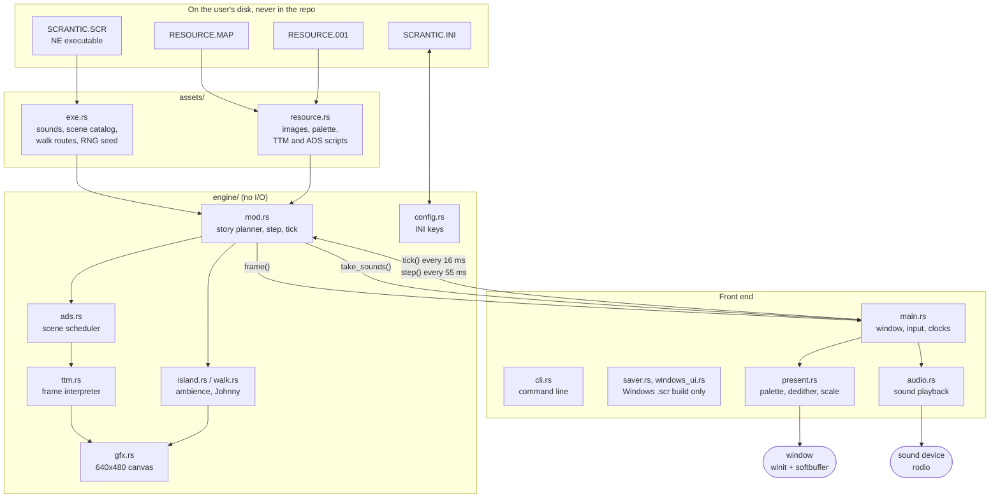

## 2. Startup

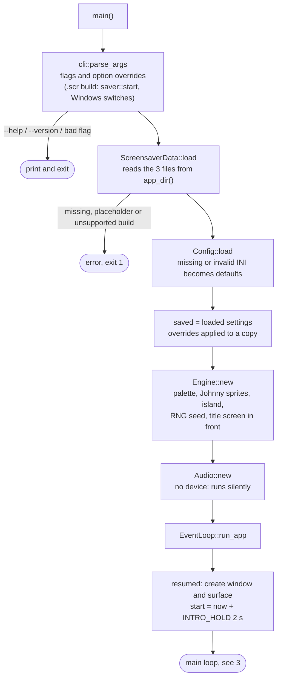

## 3. The main loop

winit drives everything. The loop sleeps until the next 55 ms step is due, advances the engine, and
asks for a redraw only when the story actually stepped.

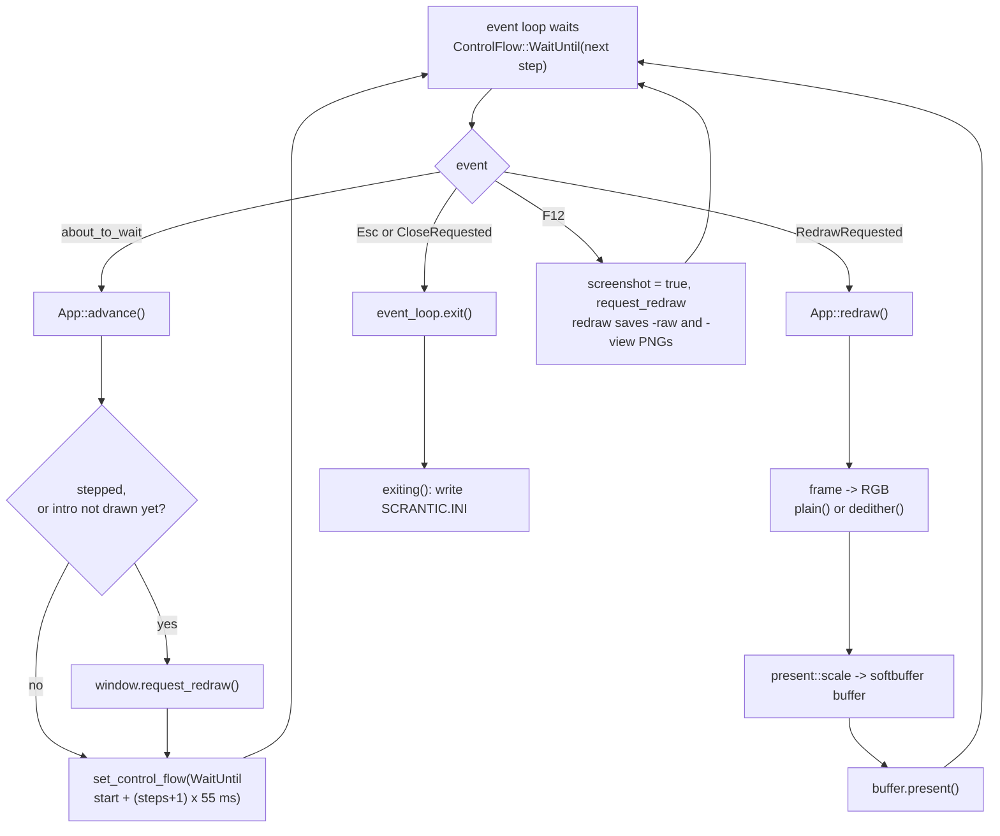

## 4. Two clocks: tick and step

The original ran two Windows 3.1 timers, and both are emulated from one wall clock. For every due step,
all ticks up to that step's virtual time run first, then the step.

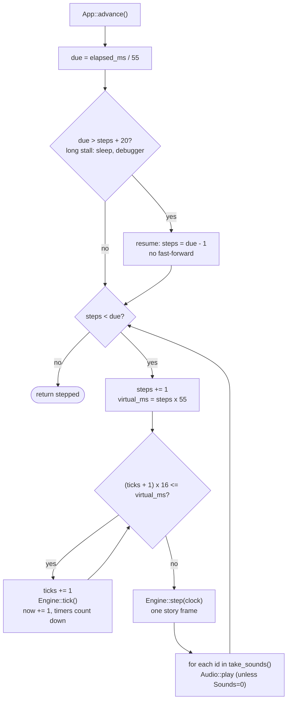

| Clock | Period | Drives |
|-------|--------|--------|
| Tick (`TICK_MS`, `seg2:16ce`) | 16 ms | script delays, walk animation, idle pause, wave and whitecap timers |
| Step (`STEP_MS`, 50 ms `WM_TIMER`, 55 ms real granularity) | 55 ms | story and scheduler: composes one frame |

## 5. One story step, end to end

From the event loop to a pixel on screen and a sound in the speaker.

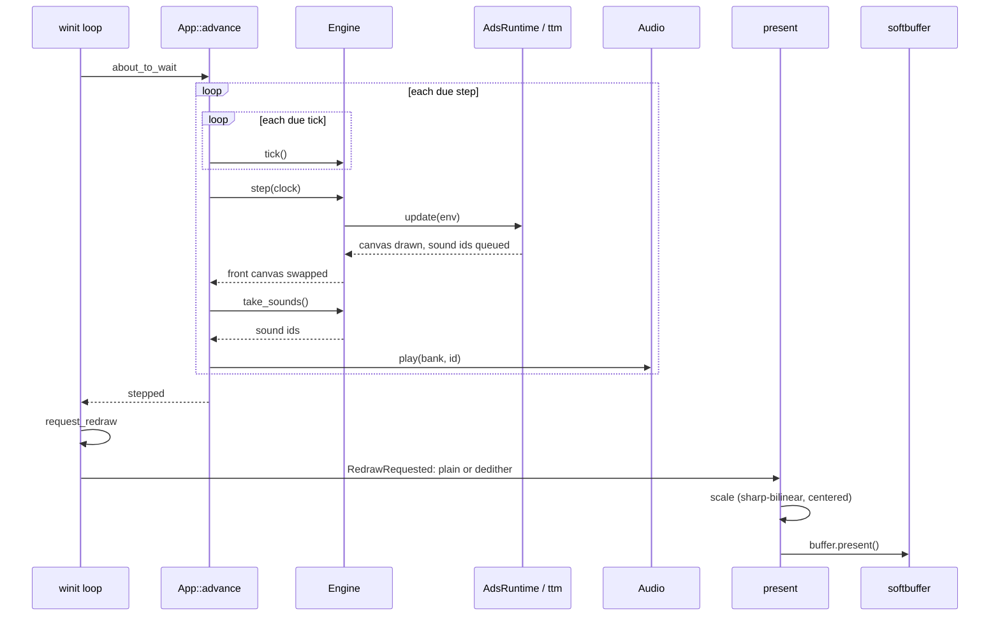

A sound starts right after the script opcode that requested it ran, the same order as the original's
synchronous `sndPlaySound` call (`seg12:0064`, see [`ENGINE.md`](ENGINE.md)).

## 6. `Engine::step`

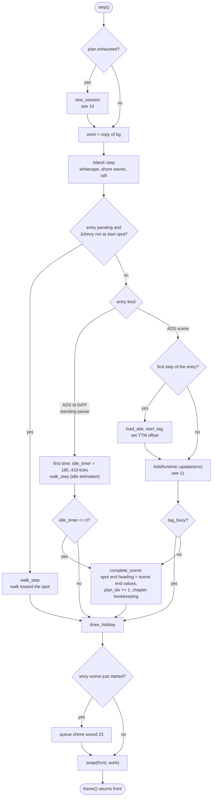

## 7. Lifecycle of a plan entry

Each entry of a session's `plan` is one catalog scene. `pending[i]` is true until its start has run.

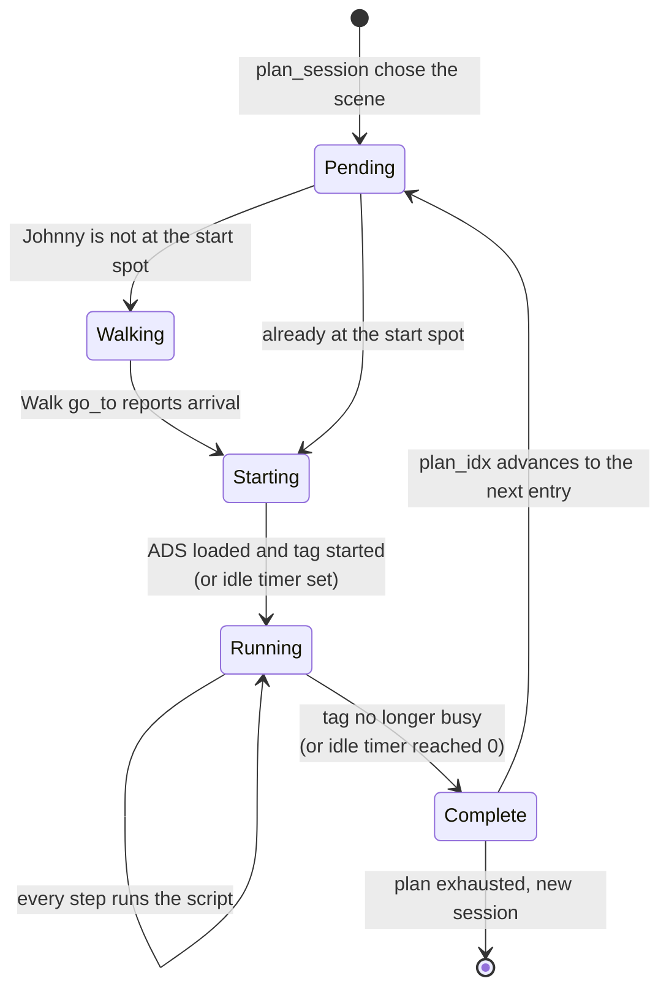

## 8. Canvases and the frame pipeline

Three 640x480 canvases of palette indices. Rebuilding `work` from `bg` on every step replaces the
original's dirty rectangles (a documented deviation).

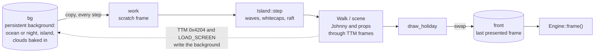

## 9. Presenting a frame

Everything here is presentation only: the engine's canvas is untouched. The original showed the canvas
centered at 1:1 on a black full-screen window; the scaling below is a deliberate enlargement.

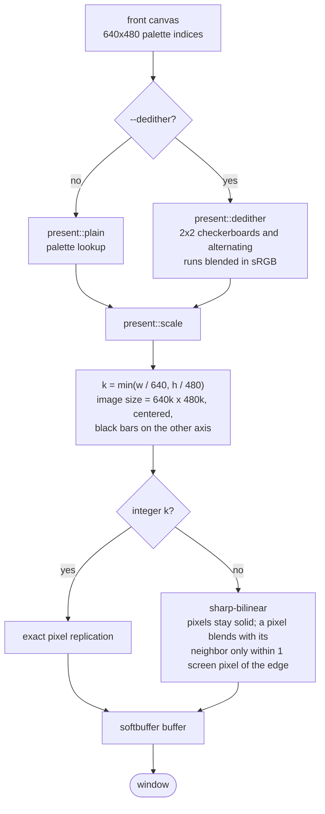

## 10. Story planning

A **session** is the list of scenes Johnny plays through; when it runs out, a new one is planned.

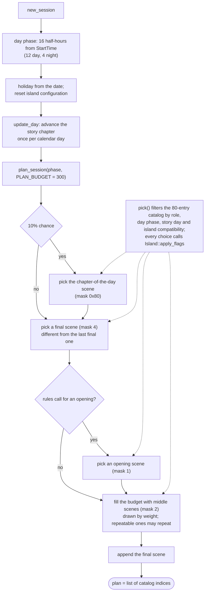

## 11. Scripts: the ADS scheduler and TTM frames

Two languages, one on top of the other: ADS sequences, TTM animates.

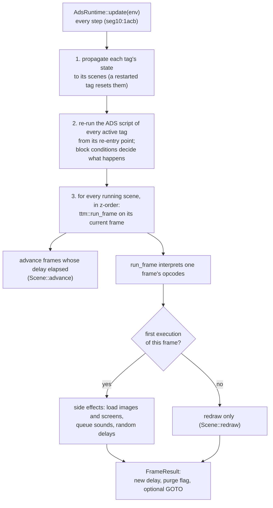

`Env` is everything a frame may touch: the three canvases, the archive, Johnny's sprites, the RNG, the
sound queue, the island offset and the tick counter.

## 12. Sound

The original called `sndPlaySound(ptr, SND_MEMORY | SND_ASYNC | SND_NODEFAULT)`: a new sound cuts the
previous one, and the game did no buffering of its own.

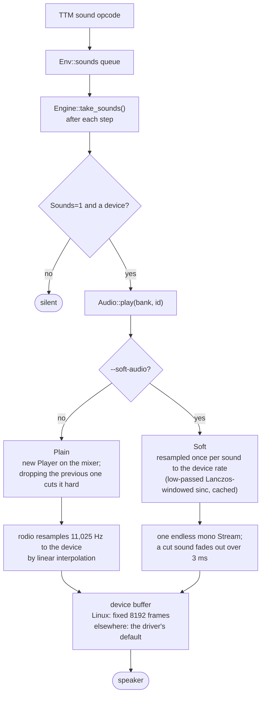

## 13. Settings: `SCRANTIC.INI` and the command line

Four options (`Background`, `Clouds`, `Waves`, `Sounds`) can be overridden for one run. The rest of the
file is story progress and is not user-facing.

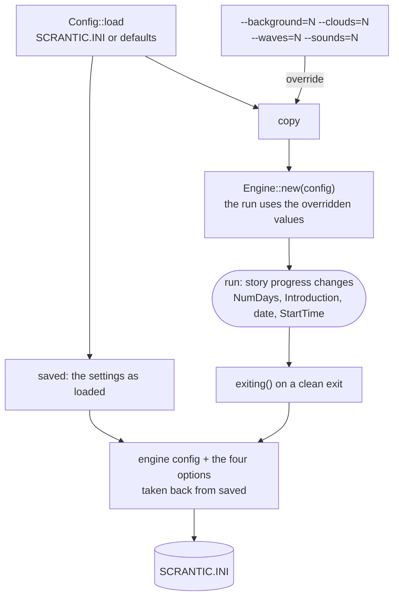

An override therefore never reaches the file, while story progress does. A crash or a kill writes nothing.
