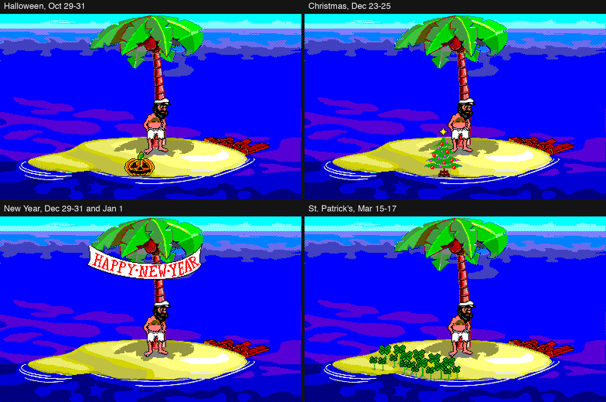

# How Johnny Castaway works

For how the Rust code is organized, see [`ARCHITECTURE.md`](ARCHITECTURE.md).

Reverse-engineering notes on `SCRANTIC.SCR` (Win16 NE executable, Borland C++ 1991, 13 code
segments + DGROUP). Addresses are written as `segment:offset`; `DS:xxxx` is the data segment.

## Resource files

- `RESOURCE.MAP`: 6-byte header, volume name (13 bytes), `u16` count, `(u32 hash, u32 offset)`
  entries. In `RESOURCE.001`, each resource is: name (13 bytes), `u32` size, data.
- Each resource is a sequence of `TAG:` chunks + `u32` size (bit 31 = container).
- Compression (`BIN:`, `SCR:`, `TT3:`): method byte + `u32` size; 1 = RLE, 2 = LZW
  (9–12-bit LSB-first codes; code 0x100 resets the dictionary and realigns the bit stream).
- Images are 4 bpp (high nibble first); index 0 (magenta) is transparent. The `VGA:` chunks are
  irrelevant (noise); the `JOHNCAST.PAL` palette only uses 16 colors (6 bits per channel).

## TTM: animation scripts (`seg12:040c`)

- `u16` instructions: the low nibble is the number of `i16` arguments (0xF = NUL-terminated string,
  padded to an even size). The script is split into *frames* at each `0x0FF0` (UPDATE); `PAG:`
  gives the frame count.
- Each `0x1111 tag` defines a **scene** starting at that frame. `0x1201` (GOTO) resolves to the
  frame whose **first** opcode is `0x1101/0x1111` with that tag.
- A frame executed for the first time has side effects (loading images/screens, sounds, random
  delay); afterwards it only redraws (flag `+0x0E` of the scene record).
- Opcodes used: sprites `0xA5x4` (bits 4–7 = mirroring: 2 horizontal, 1 vertical), line
  `0xA0A4` (end point not drawn, like `LineTo`), rectangle `0xA104`/`0xA114`, ellipse
  `0xA404/0xA424` (radius = h/2), pixel `0xA002`, clip `0x4004` (inclusive), "copy to background"
  `0x4204`, delay `0x1021` (16 ms ticks), random delay `0x2022` (`a + rand % (b - a)`),
  sound `0xC051`, end of scene `0x0110`, save/restore zone `0xA054/0xA064`.
- Drawing, clip and copy coordinates get the island offset (`origin.x + 1`, `origin.y`),
  plus 272 px for scenes with flag `0x400`.

## ADS: sequencing (`seg10`)

- Sections (tags) separated by `0xFFFF`. Block language: conditions `0x13x0`
  (`0x1330` never played, `0x1350` just finished, `0x1360` stopped, `0x1370` running),
  `AND 0x1420`/`OR 0x1430` evaluated left to right with short-circuiting,
  `ELSE 0x1500`, `ENDIF 0x1510`, `RANDOM 0x3010 … 0x30FF` (weights; `0x3020` = do nothing).
- `0x2005 slot tag n`: starts a scene (`n=0` once, `n>0` n times, `n<0` for −n ticks);
  `0x2010` stops it; `0x4000/0x4010` brings the scene to the front/back; `0xF010` stops a tag;
  `0xF200` starts another tag in parallel.
- Scheduler, on every step: propagates tag state to their scenes, **re-evaluates the whole script
  of every active tag**, then executes (draws) the current frame of every scene in drawing order,
  advancing it when its delay has elapsed. A tag is "done" when none of its scenes is still running
  (scenes that GOTO their own frame count as infinite loops and do not block).

## Story (`seg4`)

- Catalog of 80 scenes at `DS:1756` (17 bytes each): weight, start and end spots/headings,
  duration, time-of-day window, story day, flags (role: 1 opening, 2 middle, 4 final,
  8 repeatable; island modifiers: tide, night, no island, no raft, frozen waves; island position
  constraints), ADS id and tag. Scenes with ADS `0xFF` are standing pauses (3–7 s).
- Each **session** picks: with a 10% chance the chapter of the day, a final scene, an opening scene
  and middle scenes drawn by weight until a budget of 300 duration units is spent, respecting
  compatibility with the island position already decided.
- **Day/night cycle**: 16 half-hours starting at `StartTime` (9:00 by default): 12 of day
  (random `OCEAN0x.SCR`) and 4 of night (`NIGHT.SCR`).
- **Chapters** (11): `NumDays` advances one per calendar day, as long as the current chapter has
  already been shown; after the 11th it starts over. The raft grows with the day (5 stages).
- **Holidays**: chosen from the system date each time a session starts (`seg4:0540`, the checks at
  `seg4:05b5..0625`), stored in `DS:30BC`:

  | Id | Holiday        | Dates          | `HOLIDAY.BMP` sprite | Position from the island origin | Sprite size |
  |----|----------------|----------------|----------------------|---------------------------------|-------------|
  | 1  | Halloween      | Oct 29-31      | 0                    | (0x19B, 0x12A)                  | 40 x 34     |
  | 2  | Christmas      | Dec 23-25      | 2                    | (0x195, 0x10B)                  | 56 x 65     |
  | 3  | New Year       | Dec 29-31, Jan 1 | 3                  | (0x16A, 0x9B)                   | 152 x 47    |
  | 4  | St. Patrick's  | Mar 15-17      | 1                    | (0x14E, 0x11E)                  | 128 x 48    |

  

  The image was made with the snapshot example, one run per date (`DATE=1030`, `1224`, `1231`, `0316`, seed
  12345, 30 steps, for instance `DATE=1224 cargo run --release --example snapshot -- INSTALL_DIR OUT 30 30 1000 12345`),
  cropped to the island (x 250..640, y 140..380), scaled 2x and joined in a 2x2 sheet.

  The decoration is drawn on top of the scene (`seg3:1e50`) only when a holiday is set, `HOLIDAY.BMP` is
  loaded, `DS:30B6` is non-zero (the port clears it for scenes with the flag `0x10`) and `DS:30B4` is not 2
  (no island). The size is the rectangle the original tests against its dirty rectangles (`seg13:04b2`) to
  decide whether the decoration needs redrawing; the port redraws the whole frame every step, so it does
  not use it. These are the only dates the original reads for behavior. The other use of the date
  (`seg4:0ba5`) only detects that the calendar day changed, which advances the story chapter: there are no
  birthdays, weekdays or other special days.

## Walking

Six spots on the island; routes per (from, to) pair at `DS:0A96`, with alternative paths drawn by
percentage; 34 frame paths `(sprite|mirror, x, y)`; turning the shortest way (random at 180°).
When Johnny's feet are above `origin.y + 293` and he crosses the trunk, the trunk is redrawn in
front of him.

## Timing and randomness

- 16 ms tick for delays and timers: a software timer table driven by `GetCurrentTime` has a base of
  `1000 / (13×18)` = 4 ms (integer division, `seg9:076a` called with 13), and the tick callback `seg2:16ce` is
  registered with a factor of 4 (`seg2:152a`), so 4 × 4 = 16 ms. The story step runs on the 50 ms
  `WM_TIMER` (actual 55 ms granularity on Windows 3.1). Both are emulated.
- Additive lagged generator over a 56-word table (`DS:1CE6`), warmed up by discarding
  `time() & 0xFFFF` numbers.
- Sounds: `WAVESFX1..25` resources (11 and 13 are missing), 8-bit, 11,025 Hz; a new sound cuts
  the previous one. `WAVESFX25` is the chime played when the chapter of the day starts. The play routine
  (`seg5:00ba`) returns unless `Sounds` (`DS:00BC`) is set, the id is 1..25 and its far pointer in the table at
  `DS:3556` (4 bytes per id) is non-null, then calls `sndPlaySound(ptr, 7)` (`seg5:00fb`):
  `SND_MEMORY | SND_ASYNC | SND_NODEFAULT`, without `SND_NOSTOP`, so the driver cuts the previous sound.
  The game does no buffering or scheduling of its own. The only other multimedia call, `mciSendCommand(MCI_CLOSE)`
  on exit (`seg5:0085`, device id `DS:35F0`), never runs: nothing stores a device id (initially 0), so there is no
  MCI music or other MCI audio to reproduce. The routine has two callers: the script interpreter's sound opcode
  (`seg12:0064`, `push si; callf seg5:00ba`), so a sound starts synchronously while the opcode runs inside the
  50 ms step, and the chapter chime (`seg4:0895`, id 25).

## Hidden and unused content in the original

A search of `SCRANTIC.SCR` and the 41 TTM and 10 ADS scripts for easter eggs found none of the usual kind.
What it found, and what it ruled out:

- **Options outside the dialog.** The settings dialog (resource 1) has only *Load Background*
  (`Background`), *Sounds*, *Password* and *Start of day*. `Clouds` and `Waves` are read from the INI
  (`seg1:0c5c`) but never offered, so they are hidden settings.
- **Text drawing nobody uses.** The TTM interpreter implements string drawing (`TextOut` in `seg7:04ee`, font `WILLY.FON`,
  "Willy Beamish Dialog", from another Dynamix game; the font is registered by `seg7:0765`), and it has a
  family of `C0xx`/`CF01` media opcodes besides the sound opcode `C051`. No script uses any of them, so
  Johnny never speaks. Together with the dead MCI call this is leftover engine capability, not content.
- **One scene is never scheduled.** `STAND.ADS` defines tags 1-12 and 14-16, and the scene catalog has all of
  them except 14 (it runs scene 42 of `MJAMBWLK.TTM`, which tag 15 also uses inside a longer sequence). The
  original never plays it: it has no catalog entry and nothing in the scripts starts it. The port does not
  play it either.
- **Opcodes the port ignores.** The scripts use `A601`, `4214`, `1101` and `1111`, which are no-ops in the
  original too (`seg12`, switch at `0x068f`; the draw switch at `0x015f`), and `1061` and `F05F`, which only
  select the one palette (`JOHNCAST.PAL`). `1121` and `2012` store values in the script context; their
  consumers were not traced.
- **Ruled out.** No key or mouse handling beyond the standard screensaver rules (any key, or a move of more than
  3 px, ends it; `seg1:0221`). Only `/c` and `/s` on the command line. The only dates read are the holidays and
  the calendar-day change. The string `Dynamix, JTP - Jeff Tunnell Productions` is the XOR key of the password
  scrambling (`seg5:0106`), never shown. The other strings are file names, INI keys and error messages.

## Original quirks kept on purpose

These look like bugs but match the disassembly (checked against `seg3`, `seg4` and `seg12`), so do
not "fix" them:

- **Save/restore zone (`0xA054`/`0xA064`)**: both are skipped when a frame only redraws (the
  first-run flag at scene record `+0x0E`). The save reads the background buffer and the restore
  writes the work buffer.
- **A chapter scene can be dropped from its session**: the opening scene of a non-final chapter
  joins the plan only on a 5% roll per pick (50% for scenes with flag 1). If the budget runs out
  first, it is never played, yet the chapter still advances (`seg4:08b9`, `0ba5`).
- **The final-scene pick can spin**: it repeats until the scene differs from the previous final
  one, with no exit (`seg4:0911`). The port bounds this (`MAX_FINAL_PICKS`) and falls back to the
  first final scene; see the deliberate differences below.

## Deliberate differences from the original

- The original draws with dirty rectangles across three buffers; here every step recomposes the
  whole frame (background + that step's drawing). The result is the same, except for small
  artifacts of the original (e.g. shore waves "reverting" to their first frame when something
  passes over them).
- Malformed or truncated files are reported as errors instead of crashing, and the loaders cap the
  size of decompressed data.
- Limits the original does not have, all far above anything the installed files need, so that tampered data
  cannot exhaust memory, time or the stack: 16 MiB of decoded `WAVE` data (`assets/exe.rs`), one copy of the
  volume with entries as ranges (`resource.rs`), 100,000 instructions per TTM, 2M pixels per BMP, 16 TTMs and
  250,000 instructions per ADS, 32 picture or bitmap loads per TTM frame, 32 levels of nested ADS blocks, an LZW
  stream must start with a literal, and the engine refuses a scene catalog without a final scene. Error
  messages escape control characters and cap data-file text (`AssetError`). TTM `rect` and `ellipse` only visit
  the part inside the clip; the pixels drawn are the same.
- The final-scene pick gives up after a bounded number of draws instead of looping forever.
- The title screen stays up for 2 s (on 1992 hardware it was visible while the first session loaded).
- `--dedither` / `Dedither=1` (`src/present.rs`, not in the original, off by default) replaces every 2x2 checkerboard (`a b / b a`)
  with the average of its two colors, taken in the palette's own sRGB values (not in linear light); the dither of the original is this pattern in
  two palette indices. Where a dithered area ends in a one-pixel line, alternating runs of 4 or more
  pixels (rows and columns) are blended too, minus an end pixel that touches an equal neighbor (the
  edge of a solid area). It only affects the pixels sent to the window; off by default.
- Window scaling (`present::scale`, not in the original) is sharp-bilinear at the largest factor that fits, centered
  with black bars: pixels stay solid and blend with the neighbor only within one screen pixel of an edge. An
  integer factor is exact pixel replication. Always on. The original never enlarged: it created a popup window of
  the whole screen (`CreateWindow` at `seg1:019f`, size from `GetSystemMetrics(SM_CXSCREEN/SM_CYSCREEN)`), set
  the 640x480 canvas and presentation mode 3 in `seg1:1448`, and the draw routine (`seg8:07e8`) centers the canvas
  at 1:1 (`(screen - canvas) / 2` added to the destination) on a black background (`WM_ERASEBKGND` fills with
  `BLACK_BRUSH`). Its other modes only scale by 2 or 1/2, never by a fraction.
- `--soft-audio` / `SoftAudio=1` (`src/audio.rs`, not in the original, off by default) resamples the 11,025 Hz sounds to
  the device rate, low-passes them and fades a cut sound out over 3 ms. Which sound plays when is
  unchanged.
- The audio device buffer is a fixed 8192 frames on Linux (rodio's default is 50 ms, which underruns on some
  ALSA setups) and the driver's default elsewhere. The device is reopened on the next sound after a
  non-underrun stream error.
- Ellipses and lines use their own rasterization, which may differ by 1 px from GDI.
- The configuration dialog and the screensaver password were not reimplemented (options can be
  edited in the INI). Features this screensaver does not use (animated palettes, 256 colors, ADS
  variables) were not implemented.
